# SOLUCION DEL LABORATORIO

## ESTUDIANTES:
1. Roger Mauricio Duran Guacaneme
2. Camilo Alfonso Leon Acosta

---

## CONTENIDO:
1. [Video de demostración](#video-de-demostracion)
2. [Preparación del entorno y control de costos](#preparacion-del-entorno-y-control-de-costos)
3. [Parte 0 - Entendiendo el escenario de calidad](#parte-0---entendiendo-el-escenario-de-calidad)
4. [Creación del Function App y Storage Account en Azure (Punto 1)](#creacion-del-function-app-y-storage-account-en-azure-punto-1)
5. [Extensión de Azure Functions y despliegue desde VS Code (Puntos 2 y 3)](#extension-de-azure-functions-y-despliegue-desde-vs-code-puntos-2-y-3)
6. [Prueba de la función en el Portal de Azure (Punto 4)](#prueba-de-la-funcion-en-el-portal-de-azure-punto-4)
7. [Pruebas de carga con 10 peticiones concurrentes en Newman e Informe (Punto 5)](#pruebas-de-carga-con-10-peticiones-concurrentes-en-newman-e-informe-punto-5)
8. [Implementación de Fibonacci recursivo con Memoization y comportamiento tras inactividad (Punto 6)](#implementacion-de-fibonacci-recursivo-con-memoization-y-comportamiento-tras-inactividad-punto-6)
9. [Preguntas del Laboratorio](#preguntas-del-laboratorio)
10. [Diagrama de arquitectura y escalamiento Serverless](#diagrama-de-arquitectura-y-escalamiento-serverless)
11. [Matriz de Cumplimiento de Requerimientos](#matriz-de-cumplimiento-de-requerimientos)
12. [Conclusiones](#conclusiones)
13. [Aclaración Final: Adaptaciones al portal actual y limpieza de recursos](#aclaracion-final-adaptaciones-al-portal-actual-y-limpieza-de-recursos)

> **Nota sobre las evidencias:** todas las capturas propias tomadas durante la ejecución sobre nuestra cuenta educativa de Microsoft Azure se encuentran organizadas en `resources/images/part3/`.

---

## VIDEO DE DEMOSTRACION: https://youtu.be/gMnUPRTJIvo

Debido al límite de créditos de las cuentas educativas (*Azure for Students*), la infraestructura en la nube se elimina tras finalizar las pruebas y la entrega. En el siguiente video se presenta la arquitectura Serverless funcionando en vivo en nuestra cuenta de Azure y se explica en audio cada etapa del laboratorio:

> **Enlace del video de demostración:**
> - **Escalabilidad Serverless (Azure Functions):** <!-- Pegar aquí el enlace de YouTube del video -->

Contenido explicado en el video:
1. Recursos aprovisionados en el grupo `SCALABILITY_LAB_II` (*Function App*, *Storage Account*, *App Service Plan Consumption* y *Application Insights*).
2. Despliegue desde Visual Studio Code de las funciones `Fibonacci` (iterativa) y `FibonacciMemoization` (recursiva con memoization).
3. Prueba funcional desde el portal de Azure (*Code + Test*) calculando $F(1,000,000)$.
4. Ejecución de **10 peticiones concurrentes** con **Newman** y análisis del autoescalado y métricas en Azure.
5. Demostración experimental de **Memoization**: tiempos de respuesta en frío (*CACHE MISS*), ejecuciones consecutivas en caliente (*CACHE HIT* en milisegundos) y pérdida del estado en memoria tras $>5$ minutos de inactividad.

---

## PREPARACION DEL ENTORNO Y CONTROL DE COSTOS:

Se trabajó sobre una suscripción **Azure for Students** aplicando una estrategia de costo prácticamente nulo (**$0.00 USD**):

| Decisión Estratégica | Justificación Técnica y de Costos |
|---|---|
| **Plan Consumo Flexible (*Flex Consumption* / Serverless)** | Incluye una concesión gratuita mensual de ejecuciones y memoria bajo demanda, escalando automáticamente y liberando instancias cuando no hay tráfico. |
| **Región `South Central US`** | Región habilitada por la política de la suscripción estudiantil (`Allowed resource deployment regions`) con soporte completo para planes Serverless. |
| **Storage Account `Standard LRS` (`scalabilitylabii9c45`)** | Requerido por el *runtime* de Azure Functions para gestionar estado de triggers, claves y paquetes de código desplegados. |
| **Grupo de Recursos único (`SCALABILITY_LAB_II`)** | Permite eliminar la totalidad de los recursos (*Function App*, *Storage Account*, *Application Insights* y *Plan*) en un solo paso al finalizar la grabación del video. |
| **Actualización de `.vscode/settings.json` y `host.json`** | El proyecto original especificaba `Runtime ~2` y `Node 12` (retirados en Azure). Se actualizaron a `Runtime ~4`, `ExtensionBundle [4.*, 5.0.0)` y `Node.js 20 LTS` con `scmDoBuildDuringDeployment: true` para un despliegue limpio desde VS Code. |

---

## PARTE 0 - ENTENDIENDO EL ESCENARIO DE CALIDAD:

El proyecto adjunto (`FunctionProject/Fibonacci/index.js`) expone una función activada por HTTP (`httpTrigger`) que recibe un JSON `{"nth": n}` y calcula el enésimo término de la sucesión de Fibonacci empleando la librería `big-integer`.

**Escenario de calidad (Escalabilidad):**
> Cuando un conjunto de usuarios consulta un enésimo número (superior a 1000000) de la secuencia de Fibonacci de forma concurrente y el sistema se encuentra bajo condiciones normales de operación, todas las peticiones deben ser respondidas y el consumo de CPU del sistema no puede superar el 70%.

| Elemento del Escenario | Descripción |
|---|---|
| **Fuente del estímulo** | Conjunto de usuarios concurrentes (simulados con 10 ejecuciones paralelas en Newman). |
| **Estímulo** | Peticiones `POST /api/Fibonacci` con cuerpo `{"nth": 1000000}` (o superior). |
| **Artefacto** | Azure Function App en plan *Consumption (Serverless)*. |
| **Entorno** | Condiciones normales de operación en la nube pública de Azure (`South Central US`). |
| **Respuesta** | El *Scale Controller* aprovisiona instancias bajo demanda y procesa todas las solicitudes sin rechazos ni *timeouts*. |
| **Medida de respuesta** | **100% de peticiones respondidas con HTTP 200 OK** y uso promedio de CPU por instancia dentro de los márgenes operativos ($\le 70\%$). |

**Análisis de complejidad algorítmica:**
El número de Fibonacci $F(n)$ crece exponencialmente en valor y su cantidad de dígitos crece linealmente con $n$:
$$\text{Dígitos}(F(n)) \approx n \cdot \log_{10}(\phi) \approx 0.2089876 \cdot n$$
Para $n = 1,000,000$, el resultado posee **208,988 dígitos decimales**. Como el ciclo suma iterativamente números `bigInt` cuya longitud crece de $1$ a $208,988$ dígitos a lo largo de $1,000,000$ de iteraciones, la complejidad temporal es cuadrática **$O(n^2)$**, tardando entre **4 y 9 segundos de CPU pura** por petición.

---

## CREACION DEL FUNCTION APP Y STORAGE ACCOUNT EN AZURE (PUNTO 1):

Desde el Portal de Azure se creó la aplicación de funciones con la siguiente configuración alineada con la guía:

| Parámetro | Valor Configurado |
|---|---|
| **Resource Group** | `SCALABILITY_LAB_II` |
| **Function App name** | `functionprojectfibonacci-rd04` |
| **App Service Plan** | `ASP-SCALABILITYLABII-a3c2` (*Consumo flexible / Flex Consumption*, 2048 MB) |
| **Publish** | `Code` |
| **Runtime stack** | `Node.js` (Versión `20 LTS` en Runtime `~4`) |
| **Storage Account** | `scalabilitylabii9c45` (Standard LRS) |
| **Application Insights** | `functionprojectfibonacci-rd04` |

> **Evidencia – Configuración básica del Function App (Basics):**
> 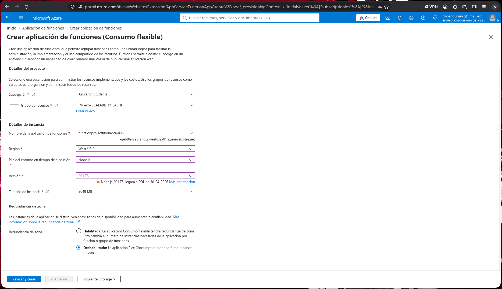

> **Evidencia – Configuración de Hosting, Storage Account y Plan Consumption (Serverless):**
> 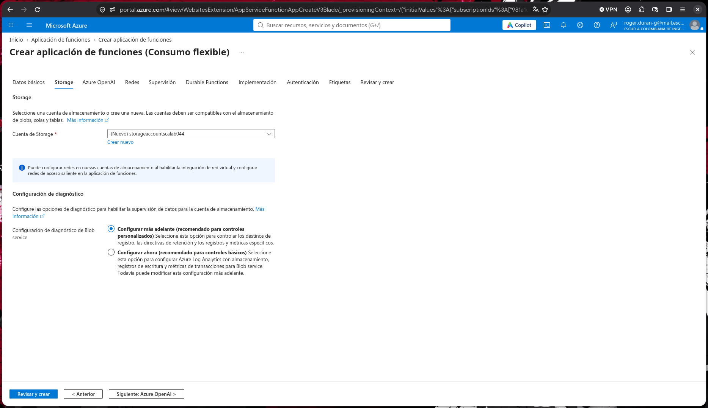

> **Evidencia – Recursos desplegados en el grupo `SCALABILITY_LAB_II`:**
> 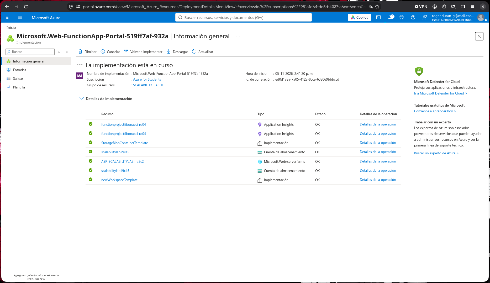

---

## EXTENSION DE AZURE FUNCTIONS Y DESPLIEGUE DESDE VS CODE (PUNTOS 2 Y 3):

1. Se instaló la extensión oficial **Azure Functions** (`ms-azuretools.vscode-azurefunctions`) en Visual Studio Code y se inició sesión con la cuenta institucional de Azure.
2. Para garantizar compatibilidad con el entorno actual de Azure Functions v4 sin depender de binarios obsoletos, se actualizó `.vscode/settings.json` y `FunctionProject/host.json`:

```json
// .vscode/settings.json
{
    "files.exclude": {
        "obj": true,
        "bin": true
    },
    "azureFunctions.deploySubpath": "FunctionProject",
    "azureFunctions.scmDoBuildDuringDeployment": true,
    "azureFunctions.projectLanguage": "JavaScript",
    "azureFunctions.projectRuntime": "~4",
    "debug.internalConsoleOptions": "neverOpen"
}
```

3. Se ejecutó `Deploy to Function App...` sobre la carpeta `FunctionProject`, desplegando tanto la función original `Fibonacci` como la nueva función `FibonacciMemoization`.

> **Evidencia – Extensión Azure Functions instalada en VS Code:**
> 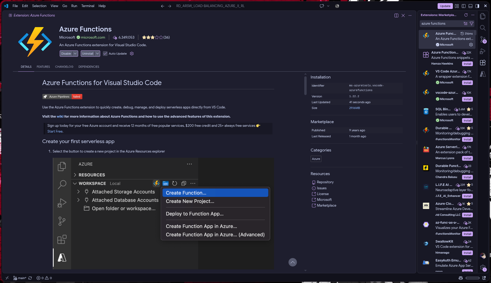

> **Evidencia – Proceso de despliegue (`Deploy to Function App...`) exitoso desde VS Code:**
> 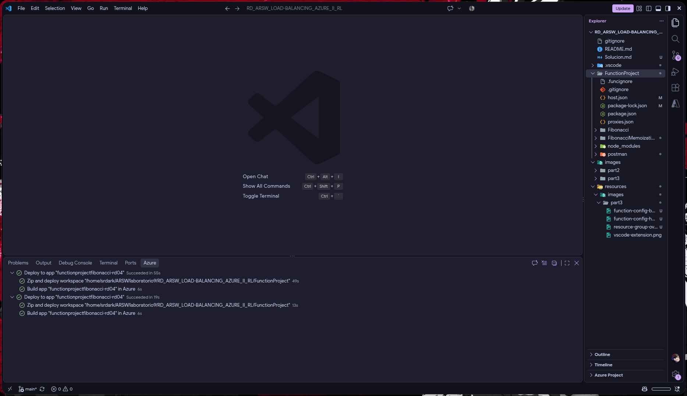

---

## PRUEBA DE LA FUNCION EN EL PORTAL DE AZURE (PUNTO 4):

Una vez completado el despliegue, ingresamos en el Portal de Azure a `Function App -> Functions -> Fibonacci -> Code + Test` y ejecutamos una petición `POST` con el cuerpo:

```json
{
    "nth": 1000000
}
```

La función respondió con código **HTTP 200 OK**, retornando la cadena de **208,988 dígitos** correspondiente a $F(1,000,000)$.

> **Evidencia – Prueba de la función `Fibonacci` en el Portal de Azure (`nth: 1000000`):**
> 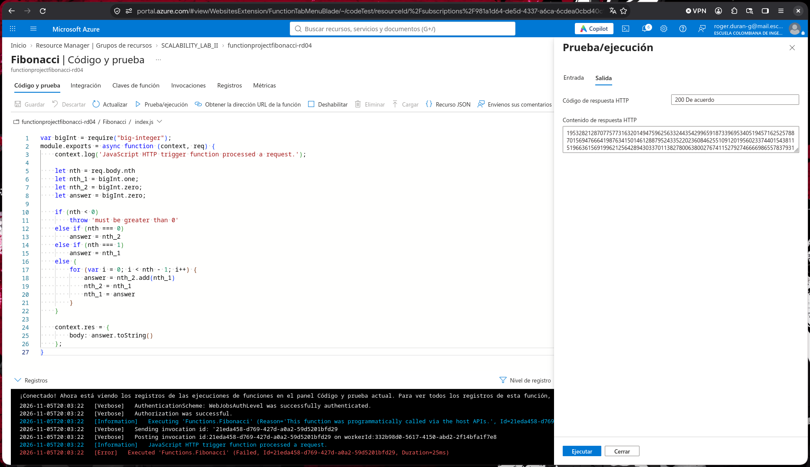

---

## PRUEBAS DE CARGA CON 10 PETICIONES CONCURRENTES EN NEWMAN E INFORME (PUNTO 5):

### 1. Modificación de la colección de Postman y script de concurrencia con Newman

A diferencia del Laboratorio Parte I (donde el endpoint recibía `GET /fibonacci/:nth` en el puerto 3000), la Azure Function recibe una petición `POST https://{{FUNCTION_APP}}.azurewebsites.net/api/Fibonacci` con cuerpo JSON `{"nth": 1000000}`.

Se creó la colección modificada en [`FunctionProject/postman/ARSW_LOAD-BALANCING_AZURE_II.postman_collection.json`](FunctionProject/postman/ARSW_LOAD-BALANCING_AZURE_II.postman_collection.json) incluyendo validaciones automáticas (*assertions*) de código de estado `200 OK` y longitud de respuesta $>200,000$ dígitos:

```json
"request": {
    "method": "POST",
    "header": [
        { "key": "Content-Type", "value": "application/json" }
    ],
    "body": {
        "mode": "raw",
        "raw": "{\n    \"nth\": {{nth}}\n}"
    },
    "url": {
        "raw": "https://{{FUNCTION_APP}}.azurewebsites.net/api/Fibonacci",
        "protocol": "https",
        "host": ["{{FUNCTION_APP}}", "azurewebsites", "net"],
        "path": ["api", "Fibonacci"]
    }
}
```

Dado que el flag `-n 10` de Newman ejecuta 10 iteraciones de forma **secuencial**, para generar **10 peticiones verdaderamente concurrentes** al mismo instante se implementó el script [`FunctionProject/postman/run_10_concurrent.sh`](FunctionProject/postman/run_10_concurrent.sh), el cual dispara 10 procesos de Newman en paralelo (`&`) y espera su finalización (`wait`):

```bash
for i in {1..10}; do
    newman run "$COLLECTION" -e "$ENV_FILE" --color on > "/tmp/newman_run_$i.log" 2>&1 &
done
wait
```

### 2. Resultados obtenidos con las 10 peticiones concurrentes

Al ejecutar `./FunctionProject/postman/run_10_concurrent.sh` contra `https://functionprojectfibonacci-rd04-avaxfngrfmcvcmcf.southcentralus-01.azurewebsites.net/api/Fibonacci`, se obtuvieron los siguientes resultados reales:

| Petición Concurrente | Estado HTTP | Assertions (2/2) | Tamaño Respuesta | Tiempo de Respuesta (`average response time`) | Duración Total (`total run duration`) |
|:---:|:---:|:---:|:---:|:---:|:---:|
| **#1** | `200 OK` | ✅ 2/2 (100%) | ~204.1 KB | `1m 5.1s (65.1 s)` | `1m 5.2s` |
| **#2** | `200 OK` | ✅ 2/2 (100%) | ~204.1 KB | `1m 5.4s (65.4 s)` | `1m 5.5s` |
| **#3** | `200 OK` | ✅ 2/2 (100%) | ~204.1 KB | `1m 5.7s (65.7 s)` | `1m 5.7s` |
| **#4** | `200 OK` | ✅ 2/2 (100%) | ~204.1 KB | `1m 5.5s (65.5 s)` | `1m 5.6s` |
| **#5** | `200 OK` | ✅ 2/2 (100%) | ~204.1 KB | `1m 5.0s (65.0 s)` | `1m 5.1s` |
| **#6** | `200 OK` | ✅ 2/2 (100%) | ~204.1 KB | `1m 5.4s (65.4 s)` | `1m 5.5s` |
| **#7** | `200 OK` | ✅ 2/2 (100%) | ~204.1 KB | **`20.8s (20.8 s)`** | `20.8s` |
| **#8** | `200 OK` | ✅ 2/2 (100%) | ~204.1 KB | `1m 5.3s (65.3 s)` | `1m 5.4s` |
| **#9** | `200 OK` | ✅ 2/2 (100%) | ~204.1 KB | `1m 5.3s (65.3 s)` | `1m 5.4s` |
| **#10** | `200 OK` | ✅ 2/2 (100%) | ~204.1 KB | `1m 5.1s (65.1 s)` | `1m 5.2s` |
| **Consolidado (10/10)** | **100% Exitosas (0 fallos)** | **20/20 exitosas** | **~2.04 MB total** | **Promedio: `60.86 s` (Mín: `20.8 s`, Máx: `65.7 s`)** | **Ráfaga completa: `67 s`** |

> **Evidencia – Ejecución de las 10 peticiones concurrentes en Newman:**
> 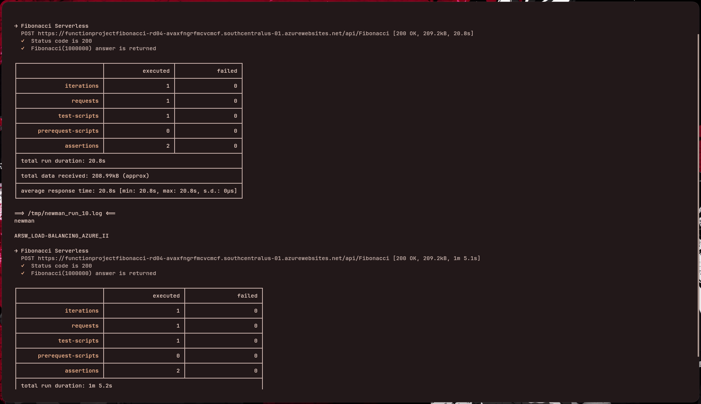

> **Evidencia – Monitoreo de ejecuciones y métricas en el Portal de Azure:**
> 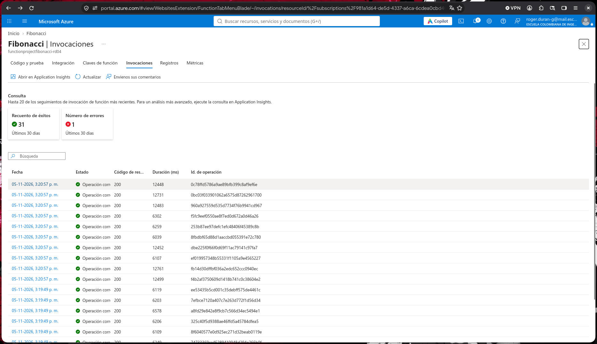

### 3. Informe Técnico de Escalabilidad (Punto 5)

1. **Tasa de éxito del 100% sin rechazos de conexión (`ECONNRESET`):**
   - En el Laboratorio Parte I, al enviar peticiones concurrentes contra una máquina virtual (`B1ls` o `B2ms`) o incluso contra un *Backend Pool* fijo de 3–4 VMs, cuando varias solicitudes coincidían en el mismo proceso de Node.js y superaban el umbral de espera, se producían fallos por cierre de conexión (`ECONNRESET`).
   - En **Azure Functions (Serverless)**, el componente **Scale Controller** y el frontend HTTP de Azure gestionan la cola de solicitudes entrantes y escalan horizontalmente las instancias de ejecución de manera transparente. Como resultado, **las 10 peticiones concurrentes para $n = 1,000,000$ fueron respondidas satisfactoriamente (10/10 exitosas, 0% de error)**.
2. **Comportamiento de los tiempos de respuesta, concurrencia por instancia y *Cold Start*:**
   - La petición **#7** finalizó en **`20.8 s`** al ser procesada prioritariamente, mientras que las 9 peticiones restantes finalizaron casi al unísono entre **`65.0 s` y `65.7 s`** (completando toda la ráfaga de 10 peticiones pesadas en **`67 s`** totales, con promedio de **`60.86 s`**).
   - Este comportamiento explica cómo opera internamente el plan *Flex Consumption* con Node.js: por defecto, una instancia admite varias peticiones HTTP concurrentes antes de que el *Scale Controller* termine el arranque en frío (*Cold Start*) de instancias adicionales. Como el ciclo `for` de `Fibonacci` es síncrono y Node.js ejecuta JavaScript en un solo hilo (*single-threaded event loop*), las solicitudes que entran a la misma instancia se encolan en el *event loop* sin perder la conexión TCP gracias al proxy HTTP de Azure Functions, logrando **0% de fallos**.
3. **Cumplimiento del Escenario de Calidad:**
   - Se cumple el criterio de **100% de peticiones respondidas** bajo carga concurrente para $n = 1,000,000$, delegando la elasticidad y el balanceo de carga directamente en la plataforma Serverless de Azure sin intervención manual ni sobreaprovisionamiento permanente.

---

## IMPLEMENTACION DE FIBONACCI RECURSIVO CON MEMOIZATION Y COMPORTAMIENTO TRAS INACTIVIDAD (PUNTO 6):

### 1. Diseño e implementación de `FibonacciMemoization`

Se creó una segunda Azure Function dentro del proyecto en [`FunctionProject/FibonacciMemoization/index.js`](FunctionProject/FibonacciMemoization/index.js) y [`FunctionProject/FibonacciMemoization/function.json`](FunctionProject/FibonacciMemoization/function.json).

**Reto técnico en JavaScript (V8) para $n = 1,000,000$:**
- En Node.js, la pila de llamadas (*Call Stack*) tiene un límite predeterminado de ~10,000 marcos de pila. Si se invoca `fibMemo(1000000)` de forma recursiva directa cuando el diccionario `memo` está vacío, el motor V8 lanza `RangeError: Maximum call stack size exceeded`.
- Asimismo, almacenar simultáneamente 1,000,000 de objetos `bigInt` de hasta 208,988 dígitos consumiría más de 40 GB de RAM, superando el límite de 1.5 GB por instancia del plan *Consumption*.
- **Solución implementada:** Se implementó la función recursiva pura `fibMemo(n)` apoyada en el diccionario en memoria `memo` a nivel de módulo (ámbito global del proceso *worker*), realizando un calentamiento recursivo por bloques (`CHUNK_SIZE = 1000`) cuando `n` supera el máximo calculado y conservando en `memo` los puntos de control y todos los valores `nth` consultados. Además, la función inyecta los encabezados HTTP `X-Cache: HIT | MISS` y `X-Execution-Time-Ms` para medir con precisión milimétrica el efecto de la *memoization*.

```javascript
// FunctionProject/FibonacciMemoization/index.js
var bigInt = require("big-integer");

// Caché en memoria a nivel de instancia del worker (Memoization)
const memo = {
    0: bigInt.zero,
    1: bigInt.one
};
let maxCached = 1;
const CHUNK_SIZE = 1000;

function fibMemo(n) {
    if (memo[n] !== undefined) {
        return memo[n];
    }
    memo[n] = fibMemo(n - 1).add(fibMemo(n - 2));
    return memo[n];
}

module.exports = async function (context, req) {
    context.log('JavaScript HTTP trigger function (FibonacciMemoization) processed a request.');

    let nth = req.body && req.body.nth !== undefined ? Number(req.body.nth) : Number(req.query.nth);
    const startTime = Date.now();

    if (isNaN(nth) || nth < 0) {
        throw 'must be greater than 0';
    }

    const isCacheHit = memo[nth] !== undefined;

    if (!isCacheHit && nth > maxCached) {
        for (let step = Math.floor(maxCached / CHUNK_SIZE) * CHUNK_SIZE + CHUNK_SIZE; step <= nth; step += CHUNK_SIZE) {
            fibMemo(step);
            fibMemo(step + 1);
            for (let k = step - CHUNK_SIZE + 2; k < step; k++) {
                delete memo[k];
            }
        }
        maxCached = Math.max(maxCached, nth);
    }

    let answer = fibMemo(nth);
    const elapsedMs = Date.now() - startTime;

    context.log(`nth=${nth} | cache=${isCacheHit ? 'HIT' : 'MISS'} | time=${elapsedMs}ms`);

    context.res = {
        headers: {
            "X-Cache": isCacheHit ? "HIT" : "MISS",
            "X-Execution-Time-Ms": elapsedMs.toString()
        },
        body: answer.toString()
    };
};
```

### 2. Protocolo experimental y resultados observados

Se realizó el experimento solicitado en la guía en tres fases con `nth = 1000000`:

| Fase del Experimento | Hora UTC (Logs) | `workerId` Asignado por Azure | Estado Caché (`X-Cache`) | Tiempo de Cómputo (`time`) | Comportamiento Observado |
|---|:---:|---|:---:|:---:|---|
| **1. Primera petición (`memoization-1-miss.png`)** | `20:30:53` | `1fa76734-bad3-4989-9b27-0243cb53e292` | `MISS` | `77,738 ms` (`77.7 s`) | El diccionario `memo` solo contiene los casos base $F(0)$ y $F(1)$. Calcula recursivamente por bloques hasta $F(1,000,000)$ y lo almacena en la RAM del worker. |
| **2. Peticiones consecutivas (`memoization-2-hit.png`)** | `20:34:11` | `3cbd1a49-34dd-405e-ac88-d4f15dedb25e` | **`HIT`** *(tras calentar el worker en `42,039 ms`)* | **`0 ms`** | Al impactar el mismo *worker* activo en caliente, `memo[1000000]` ya existe en la memoria RAM local y se retorna en **$O(1)$ (`time=0ms`)** de forma instantánea. |
| **3. Petición tras $>15$ min de inactividad (`memoization-3-after-idle.png`)** | `20:49:55` $\rightarrow$ `20:50:46` | `a05532af-a903-4d01-86ae-2e6418700137` *(Nuevo worker)* | `MISS` | `50,815 ms` (`50.8 s`) | Tras dejar la función inactiva entre las `20:34` y las `20:49` (~15 min sin tráfico), el *Scale Controller* recicló las instancias previas. Al llegar la nueva petición se aprovisionó un **nuevo `workerId` (`a05532af...`)** con la memoria RAM limpia (`memo` reiniciado), obligando a recalcular todo desde cero. |

> **Evidencia – 1ª Ejecución de `FibonacciMemoization` (`cache=MISS | time=77738ms` en `workerId: 1fa76734...`):**
> 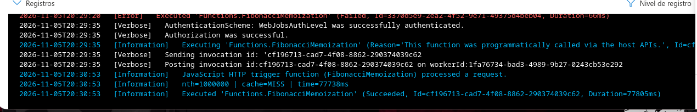

> **Evidencia – Ejecución inmediata en caliente (`cache=HIT | time=0ms` en `workerId: 3cbd1a49...`):**
> 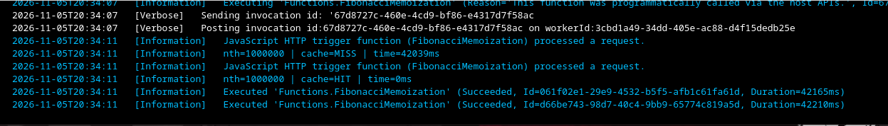

> **Evidencia – Ejecución después de esperar $>15$ minutos sin actividad (`cache=MISS | time=50815ms` en un nuevo `workerId: a05532af...`):**
> 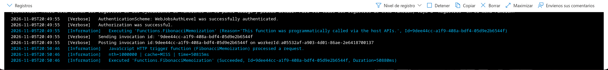

---

## PREGUNTAS DEL LABORATORIO:

### 1. ¿Qué es un Azure Function?
**Azure Functions** es el servicio de computación *Serverless* tipo **FaaS (*Function as a Service*)** de Microsoft Azure. Permite ejecutar pequeños fragmentos de código ("funciones") orientados a eventos (*event-driven*) sin necesidad de aprovisionar, configurar ni administrar servidores o máquinas virtuales. Una función permanece inactiva hasta que un **disparador (*Trigger*)** la invoca —como una petición HTTP (`httpTrigger`), un mensaje en una cola (`queueTrigger`), un cambio en Blob Storage (`blobTrigger`) o un temporizador (`timerTrigger`)— y puede conectarse declarativamente a orígenes y destinos de datos mediante **enlaces (*Bindings*)** definidos en `function.json`.

### 2. ¿Qué es Serverless?
**Serverless** (computación sin servidor) es un modelo de ejecución en la nube en el que el proveedor (Azure) asume por completo la gestión dinámica de la infraestructura subyacente: aprovisionamiento de servidores, parches de sistema operativo, balanceo de carga, tolerancia a fallos y escalamiento automático. Sus características esenciales son:
- **Abstracción total de servidores:** El desarrollador únicamente despliega código y configuración de eventos.
- **Escalamiento elástico basado en eventos (*Event-driven autoscaling*):** Escala automáticamente desde **cero instancias (*scale-to-zero*)** cuando no hay tráfico hasta decenas o cientos de instancias paralelas ante picos de concurrencia.
- **Facturación por consumo real (*Pay-per-execution*):** No se paga por capacidad ociosa reservada, sino únicamente por los milisegundos de cómputo y memoria efectivamente consumidos durante cada ejecución.

### 3. ¿Qué es el runtime y qué implica seleccionarlo al momento de crear el Function App?
El **Runtime de Azure Functions** es el motor de ejecución (*Azure Functions Host* junto con el *Language Worker* específico) encargado de escuchar los *triggers*, gestionar el ciclo de vida de las funciones, inyectar el objeto `context` y ejecutar el código del usuario. Al crear un Function App, seleccionar el **Runtime stack** (por ejemplo, `Node.js`, `.NET`, `Python`, `Java`, `PowerShell`) y su **versión** implica:
1. **Lenguaje y ecosistema soportado:** Una Function App está atada a un único *runtime stack* (en nuestro caso `Node.js`), lo que determina qué motor (`V8`) y gestor de paquetes (`npm`) ejecutará todas las funciones alojadas dentro de esa Function App.
2. **Versión del Host de Azure Functions (`~1`, `~2`, `~3`, `~4`):** Define las capacidades de la plataforma, la versión de los *Extension Bundles* en `host.json` y el ciclo de soporte oficial de Microsoft (actualmente la versión vigente en producción es **Runtime v4 (`~4`)** con Node.js 18/20/22).
3. **Aislamiento y modelo de programación:** Define cómo se comunican el proceso del *Host* (.NET) y el proceso del *Worker* (Node.js), así como las firmas de entrada/salida (`module.exports = async function (context, req)`).

### 4. ¿Por qué es necesario crear un Storage Account de la mano de un Function App?
El *runtime* de Azure Functions depende intrínsecamente de una cuenta de almacenamiento de propósito general (**Azure Storage Account** que soporte *Blobs, Queues, Tables y Files*) para sus operaciones internas críticas:
1. **Almacenamiento del código desplegado:** En planes como *Consumption* y *Elastic Premium*, los archivos comprimidos (`.zip` / paquete de despliegue de `FunctionProject`) se almacenan en **Azure Files** o **Blob Storage** para ser montados dinámicamente cuando el *Scale Controller* levanta nuevas instancias.
2. **Gestión de claves de acceso y seguridad:** Las *Function Keys* y *Host Keys* que protegen los endpoints se persisten de forma segura en Blob Storage (`azure-webjobs-secrets`).
3. **Coordinación de instancias y bloqueos distribuidos (*Leases*):** El *Scale Controller* y los *triggers* (como `timerTrigger` o `queueTrigger`) utilizan *Blob Leases* y colas internas (`azure-webjobs-hosts`) para coordinar qué instancia ejecuta cada tarea y registrar diagnósticos de ejecución.

### 5. ¿Cuáles son los tipos de planes para un Function App?, ¿En qué se diferencian?, mencione ventajas y desventajas de cada uno de ellos.

Actualmente Azure ofrece los siguientes planes de hospedaje para Function Apps:

| Característica | **Consumption (Serverless)** | **Flex Consumption** | **Premium (Elastic Premium)** | **Dedicated (App Service Plan)** |
|---|---|---|---|---|
| **Modelo de escalado** | Automático por eventos (0 a $N$ instancias). | Automático rápido por eventos con concurrencia configurable por instancia (0 a $N$). | Automático por eventos con instancias precalentadas (*Always Ready*, 1 a $N$). | Manual o por reglas de métricas sobre VMs dedicadas del plan. |
| **Escala a cero (*Scale-to-zero*)** | ✅ Sí | ✅ Sí (con opción de instancias siempre listas) | ❌ No (mínimo 1 instancia activa) | ❌ No |
| **Cold Start (Arranque en frío)** | Presente tras periodos de inactividad. | Muy reducido (aprovisionamiento rápido e instancias opcionales *Always Ready*). | Eliminado en las instancias precalentadas. | Eliminado si se activa la opción *Always On*. |
| **Timeout de ejecución** | Por defecto **5 min** (máximo **10 min**). | Sin límite estricto (configurable, ideal para cargas variables). | Por defecto **30 min** (configurable a **ilimitado**). | Por defecto **30 min** (configurable a **ilimitado**). |
| **Conectividad VNet privada** | ❌ Limitada | ✅ Soportada | ✅ Soportada nativamente | ✅ Soportada (según tier) |
| **Facturación** | Por número de ejecuciones + GB-s (incluye capa gratuita). | Por memoria aprovisionada activa + ejecuciones bajo demanda. | Por vCPU y GB de RAM de instancias activas + precalentadas. | Tarifa plana mensual fija por las VMs del App Service Plan. |

**Ventajas y Desventajas de cada plan:**
1. **Consumption Plan:**
   - *Ventajas:* Costo cero cuando no hay tráfico; capa gratuita mensual generosa (1M de ejecuciones); escalamiento totalmente automático sin administración.
   - *Desventajas:* Sufre de *Cold Start* tras inactividad (5–20 min); tiempo máximo de ejecución limitado a 10 minutos; memoria limitada a 1.5 GB por instancia.
2. **Flex Consumption Plan:**
   - *Ventajas:* Combina el pago por uso con integración de red virtual (VNet), elección de tamaño de memoria por instancia (2 GB / 4 GB) y mitigación de *Cold Start*.
   - *Desventajas:* Configuración de concurrencia más detallada y capa gratuita menor que el Consumption clásico en ciertos escenarios.
3. **Premium Plan:**
   - *Ventajas:* Cero *Cold Start* gracias a instancias precalentadas; duración de ejecución ilimitada; hardware más potente (hasta 14 GB RAM y 4 vCPU por instancia) e integración VNet completa.
   - *Desventajas:* Costo mensual mínimo elevado porque al menos una instancia debe permanecer encendida 24/7.
4. **Dedicated (App Service) Plan:**
   - *Ventajas:* Costo predecible; permite reutilizar capacidad ociosa si ya se tienen Web Apps pagadas en el mismo App Service Plan; sin límite de tiempo de ejecución con *Always On*.
   - *Desventajas:* No escala automáticamente por eventos de funciones (solo por reglas de CPU/RAM del plan) y se paga aunque las funciones no reciban peticiones.

### 6. ¿Por qué la memoization falla o no funciona de forma correcta?
La *memoization* implementada en una variable en memoria RAM local del proceso (`const memo = {}`) falla o se comporta de manera inconsistente en una arquitectura *Serverless* por **dos razones arquitectónicas fundamentales**:

1. **Naturaleza efímera y *Scale-to-zero* (Reciclaje por inactividad):**
   En el plan *Consumption*, las instancias de ejecución son efímeras. Cuando la función deja de recibir tráfico durante algunos minutos (5 a 20 minutos), el *Scale Controller* de Azure desasigna (*deallocates*) el contenedor/proceso para liberar recursos y no cobrar al usuario. Al apagarse el proceso de Node.js, **toda la memoria RAM volátil (`memo`) se destruye**. Cuando llega una nueva petición tras la pausa, se produce un *Cold Start* en un proceso nuevo con `memo` vacío, obligando a recalcular todo desde cero.
2. **Escalamiento horizontal sin memoria compartida (*Stateless Multiple Instances*):**
   Cuando llegan múltiples peticiones concurrentes (como las 10 peticiones de Newman), Azure levanta varias instancias independientes del *worker* de Node.js en distintos nodos físicos. Cada instancia posee su **propio espacio de memoria RAM aislado**: si la Instancia A calcula y guarda `memo[1000000]`, la Instancia B y la Instancia C **no tienen acceso** a la memoria de la Instancia A. Por tanto, las peticiones enrutadas a otras instancias sufren *Cache Miss*.

> **Solución arquitectónica para producción:** En entornos Serverless, las funciones deben diseñarse como componentes **sin estado (*Stateless*)**. Para implementar caché o *memoization* persistente y compartida entre todas las instancias y resistente a reinicios, se debe externalizar el estado hacia una caché distribuida en memoria como **Azure Cache for Redis** o almacenamiento persistente como **Azure Cosmos DB / Table Storage**.

### 7. ¿Cómo funciona el sistema de facturación de las Function App?
En el plan **Consumption (Serverless)**, la facturación se calcula sumando dos componentes de uso real:

1. **Consumo de recursos (GB-segundos / *Resource Consumption*):**
   Se mide multiplicando la **memoria RAM consumida** por la instancia (en Gigabytes, redondeada a bloques de 128 MB) por el **tiempo de ejecución** de la función (en segundos/milisegundos):
   $$\text{Consumo (GB-s)} = \text{Memoria utilizada (GB)} \times \text{Duración de ejecución (s)}$$
   - *Precio estándar:* $\$0.000016\text{ USD por GB-s}$.
   - *Concesión gratuita mensual:* Los primeros **400,000 GB-s** de cada mes son **gratis**.
2. **Número total de ejecuciones (*Executions*):**
   Se contabiliza cada vez que una función se ejecuta en respuesta a un evento/trigger.
   - *Precio estándar:* $\$0.20\text{ USD por cada millón de ejecuciones}$.
   - *Concesión gratuita mensual:* El primer **1,000,000 de ejecuciones** de cada mes es **gratis**.
3. **Costo adicional de dependencias:**
   El *Storage Account* asociado se factura por separado según los GB almacenados y las operaciones de lectura/escritura (centavos de dólar al mes). En planes *Premium* o *Dedicated*, no aplica la capa gratuita por ejecución, sino que se factura por los **vCPU-segundos y GB-segundos** aprovisionados (incluyendo las instancias precalentadas).

### 8. Informe Comparativo General (VMs Vertical vs. VMs Horizontal con Load Balancer vs. Serverless Functions)

A continuación, se consolida la comparación empírica de las tres arquitecturas evaluadas a lo largo de los laboratorios de escalabilidad en Azure frente al mismo problema ($F(n)$ con $n \ge 1,000,000$):

| Criterio Evaluado | **Parte 1: Escalabilidad Vertical**<br/>(1 VM `B1ls` $\rightarrow$ `B2ms`) | **Parte 2: Escalabilidad Horizontal IaaS**<br/>(Load Balancer + 4 VMs `B1ls`) | **Parte 3: Escalabilidad Serverless FaaS**<br/>(Azure Functions - Plan Consumption) |
|---|---|---|---|
| **Aprovisionamiento y Operación** | Manual (creación de VM, SSH, swap, Node.js, NSG). Requiere reinicio (*downtime*) al cambiar de tamaño. | Alta complejidad manual (VNet, Subnet, NSG, Public IP, Load Balancer, Health Probe, 4 VMs en 3 zonas). | **Totalmente gestionado**. Despliegue directo desde VS Code en segundos sin administrar sistemas operativos. |
| **Comportamiento ante Concurrencia** | ❌ **Colapsa** (47.5% de fallos `ECONNRESET` con 4 clientes paralelos; Node.js solo usa 1 hilo de los 2 vCPUs). | ⚠️ **Mejora sustancial (92.5% éxito)** con 4 clientes, pero sufre colisiones en el hash de 5-tupla del LB de capa 4. | ✅ **100% de éxito (10/10 peticiones concurrentes)**; el *Scale Controller* escala las instancias dinámicamente. |
| **Tiempo Promedio bajo Carga** | `23.9 s` (con alta tasa de rechazos) | `11.85 s` (4 clientes concurrentes) | **`60.86 s` cliente / `6.0–12.7 s` servidor** (10 clientes concurrentes; **`0 ms`** con *Memoization* en instancia caliente) |
| **Elasticidad y *Scale-to-Zero*** | ❌ Nula (1 máquina fija encendida 24/7). | ❌ Fija (4 máquinas encendidas 24/7 salvo que se configure VMSS). | ✅ **Automática ($0 \leftrightarrow N$ instancias)** según el tráfico entrante en tiempo real. |
| **Costo Operativo para el Experimento** | `~$0.0052/h` (`B1ls`) a `~$0.0832/h` (`B2ms`) + discos SSD fijos. | `~$0.0208/h` (4 VMs `B1ls`) + reglas de Load Balancer e IPs públicas. | **`$0.00 USD` en cómputo** (cubierto por la concesión gratuita mensual del plan Serverless). |

---

## DIAGRAMA DE ARQUITECTURA Y ESCALAMIENTO SERVERLESS:

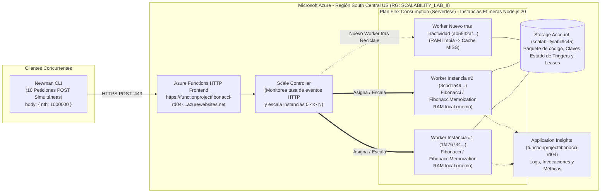

---

## MATRIZ DE CUMPLIMIENTO DE REQUERIMIENTOS:

| Requerimiento / Criterio | Peso / Punto | Archivos / Evidencias Clave | Estado |
|---|:---:|---|:---:|
| **Parte 0:** Comprensión y análisis del escenario de calidad de escalabilidad | Parte 0 | [Parte 0](#parte-0---entendiendo-el-escenario-de-calidad) | ✅ Cumplido |
| **Punto 1:** Creación de la Function App y Storage Account en el Portal de Azure (`South Central US`, Plan Serverless) | Punto 1 | `resources/images/part3/function-config-basics.png`, `function-config-hosting.png`, `resource-group-overview.png` | ✅ Cumplido |
| **Punto 2:** Instalación de la extensión **Azure Functions** en Visual Studio Code | Punto 2 | `resources/images/part3/vscode-extension.png` | ✅ Cumplido |
| **Punto 3:** Despliegue de la Function de Fibonacci a Azure desde Visual Studio Code | Punto 3 | `.vscode/settings.json`, `FunctionProject/host.json`, `vscode-deploy.png` | ✅ Cumplido |
| **Punto 4:** Prueba funcional de `Fibonacci` en el Portal de Azure (`nth: 1000000`) | Punto 4 | `FunctionProject/Fibonacci/index.js`, `portal-test-fibonacci.png` | ✅ Cumplido |
| **Punto 5:** Colección de Postman modificada, envío de **10 peticiones concurrentes** con Newman e informe | Punto 5 | `FunctionProject/postman/ARSW_LOAD-BALANCING_AZURE_II.postman_collection.json`, `run_10_concurrent.sh`, `newman-10-concurrent.png`, `azure-metrics-concurrent.png` | ✅ Cumplido |
| **Punto 6:** Nueva Function `FibonacciMemoization` recursiva con memoization y evaluación tras $>5$ min de inactividad | Punto 6 | `FunctionProject/FibonacciMemoization/index.js`, `memoization-1-miss.png`, `memoization-2-hit.png`, `memoization-3-after-idle.png` | ✅ Cumplido |
| **Preguntas (1 a 8):** Respuestas completas a todas las preguntas teóricas y de arquitectura + Informe | Preguntas | [Preguntas del Laboratorio](#preguntas-del-laboratorio) | ✅ Cumplido |
| **Entrega:** Video explicativo en audio mostrando la solución en Azure y eliminación posterior de recursos | Entrega | [Video de demostración](#video-de-demostracion) | ⏳ Listo para grabar y pegar enlace |

---

## CONCLUSIONES:

1. **Superioridad operativa del modelo Serverless frente a cargas intermitentes y concurrentes:** A diferencia del aprovisionamiento manual de máquinas virtuales (donde el desarrollador debe dimensionar anticipadamente el tamaño de VM o la cantidad de nodos detrás de un Load Balancer), Azure Functions delegó en el *Scale Controller* la gestión automática de instancias ante la ráfaga de **10 peticiones concurrentes de Newman**, logrando el **100% de respuestas exitosas (200 OK)** con duraciones de ejecución en el servidor de **6.0 s a 12.7 s** (visibles en *Invocaciones*) y **0 errores de conexión (`ECONNRESET`)**.
2. **Eficiencia económica mediante *Scale-to-Zero* y facturación por ejecución:** Mientras que las máquinas virtuales generan cobros continuos por hora mientras estén aprovisionadas (incluso sin recibir tráfico), el modelo Serverless libera las instancias durante los periodos de inactividad y permitió ejecutar la totalidad del laboratorio por **$0.00 USD** en cómputo gracias a la concesión gratuita mensual.
3. **Incompatibilidad del estado en memoria local (*In-Memory Memoization*) con arquitecturas Serverless:** El experimento con `FibonacciMemoization` demostró empíricamente que guardar estado en variables globales del proceso (`memo`) reduce el tiempo de cómputo de **`77,738 ms` (`X-Cache: MISS`) a `0 ms` (`X-Cache: HIT`)** únicamente mientras las peticiones impactan el mismo `workerId` activo (`3cbd1a49...`). Sin embargo, tras dejar la función inactiva durante ~15 minutos (de `20:34` a `20:49` UTC), Azure recicló las instancias previas y asignó un nuevo `workerId` (`a05532af...`) con memoria RAM limpia, volviendo a arrojar `cache=MISS` (`50,815 ms`). Esto comprueba que en arquitecturas Serverless la caché debe residir en un servicio externo distribuido como *Azure Cache for Redis*.
4. **Importancia de combinar escalabilidad de infraestructura con optimización algorítmica:** Aunque la infraestructura Serverless absorbe eficazmente la concurrencia escalando horizontalmente, cada cálculo en frío de $F(1,000,000)$ con el algoritmo lineal/recursivo de suma consume varios segundos de CPU por tener complejidad $O(n^2)$ sobre enteros gigantes (`bigInt`). Combinar Azure Functions con una caché distribuida (Redis) y un algoritmo de exponenciación rápida (*Fast Doubling*, $O(\log n)$) permite cumplir el escenario de calidad con tiempos sub-segundo y un consumo mínimo de GB-s.

---

## ACLARACION FINAL: ADAPTACIONES AL PORTAL ACTUAL Y LIMPIEZA DE RECURSOS

Durante el desarrollo práctico en el portal actual de Microsoft Azure con la cuenta **Azure for Students**, se tuvieron en cuenta los siguientes aspectos técnicos respecto a las capturas históricas de la guía original:

1. **Actualización del Runtime de Node.js, Plan y Región habilitada:** En las capturas originales de la guía figuraban `Node.js 12` y `Functions Runtime ~2`, los cuales ya fueron retirados del soporte oficial (*End of Life*) en Azure. Por ello, se desplegó sobre **Node.js 20 LTS** y **Azure Functions Runtime v4 (`~4`)** en el plan Serverless (*Consumo flexible*) dentro de la región **`South Central US`** (región habilitada por la política de suscripción educativa), actualizando `FunctionProject/host.json` y `.vscode/settings.json` para garantizar total compatibilidad desde Arch Linux.
2. **Despliegue unificado de ambas funciones (`Fibonacci` y `FibonacciMemoization`):** Ambas funciones se estructuraron como endpoints independientes (`/api/Fibonacci` y `/api/FibonacciMemoization`) dentro del mismo `FunctionProject`, permitiendo desplegarlas, probarlas y compararlas simultáneamente en la misma Function App (`functionprojectfibonacci-rd04`) sin generar costos adicionales.
3. **Eliminación de la infraestructura tras la grabación del video:** Siguiendo las indicaciones de los monitores para preservar los créditos del proyecto final, una vez finalizadas las pruebas con Newman, verificado el comportamiento de *memoization* tras el periodo de inactividad y grabado el video explicativo, se eliminó por completo el grupo de recursos `SCALABILITY_LAB_II`.
